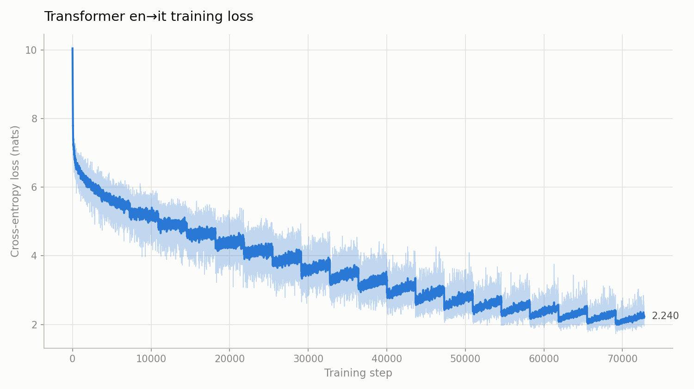

# Transformer 英→意机器翻译

从零手写实现的 Transformer（[Attention Is All You Need](https://arxiv.org/abs/1706.03762)），**不调用 `torch.nn.Transformer` 或任何现成的注意力层**——多头注意力、位置编码、残差+层归一化、编码器/解码器堆叠，全部自己在 `model.py` 里实现，并配有逐行中文注释。

任务：在 `Helsinki-NLP/opus_books` 的 `en-it` 子集上做英译意。

本文档重点讲**原理**，每一节都对应到 `model.py` 里的具体实现；跑代码的方法在文末。



---

# 一、Transformer 原理

## 0. 整体结构：为什么是编码器-解码器

翻译是一个**序列到序列**问题：输入一个变长序列，输出另一个变长序列，且两个序列长度不相等、语言不同。

Transformer 沿用了编码器-解码器的骨架：

```
        源语言句子                         目标语言句子（已生成的部分）
            │                                      │
      ┌─────▼─────┐                          ┌─────▼─────┐
      │  词嵌入    │                          │  词嵌入    │
      │ + 位置编码 │                          │ + 位置编码 │
      └─────┬─────┘                          └─────┬─────┘
            │                                      │
      ┌─────▼─────┐                          ┌─────▼─────┐
      │           │      ┌───────────┐       │           │
      │  编码器   │──────┤  交叉注意力 ├───────│  解码器   │
      │  × 6      │      └───────────┘       │  × 6      │
      │           │                          │           │
      └─────┬─────┘                          └─────┬─────┘
            │                                      │
            │                                ┌─────▼─────┐
            │                                │ 线性 +     │
            │                                │ log_softmax│
            │                                └─────┬─────┘
            │                                      │
        源句的语义表示                     每个位置上的词表概率分布
```

- **编码器**把源句压成一串向量，每个位置都融合了整个句子的上下文；
- **解码器**一边看自己已经生成的词（自注意力），一边回头查编码器的输出（交叉注意力），逐步吐出意大利语。

`build_transformer()` 负责把这一切拼起来，并在最后对所有权重做 `xavier_uniform_` 初始化。

下面按数据流的顺序逐块拆解。

## 1. 词嵌入：把词变成向量

`InputEmbedding` 就是一张查表：词表里第 $i$ 个词对应第 $i$ 行向量。

```python
def forward(self, x):
    return self.embedding(x) * math.sqrt(self.d_model)
```

关键是那个 $\sqrt{d_{model}}$ 缩放。词嵌入初始化时方差是固定的，而后面要叠加的位置编码幅值在 $[-1,1]$ 附近；乘上 $\sqrt{512}$ 让两者量级相当，避免位置信息被词义淹没。这个系数在原文里是必要的细节，漏掉会让训练变慢。

> 注意这一层是**可学习的**——初始随机，靠反向传播优化。

## 2. 位置编码：给模型装上"顺序感"

自注意力对输入是**置换等变**的：把句子里的词打乱，输出也只是跟着打乱，模型本身分不出"狗咬人"和"人咬狗"。所以必须显式地把位置信息注入进去。

原文用的是固定的正弦/余弦函数，不做学习：

$$PE_{(pos,\,2i)}=\sin\left(\frac{pos}{10000^{2i/d_{model}}}\right),\qquad PE_{(pos,\,2i+1)}=\cos\left(\frac{pos}{10000^{2i/d_{model}}}\right)$$

`PositionalEncoding` 的实现：

```python
position = torch.arange(0, seq_len, dtype=torch.float).unsqueeze(1)        # (seq_len, 1)
div_term = torch.exp(torch.arange(0, d_model, 2).float()
                     * (-math.log(10000.0) / d_model))                      # (d_model/2,)
pe[:, 0::2] = torch.sin(position * div_term)   # 偶数维用 sin
pe[:, 1::2] = torch.cos(position * div_term)   # 奇数维用 cos
```

三个要点：

- `div_term` 写成 `exp(-log(10000) * 2i / d_model)` 而不是直接算 $10000^{-2i/d_{model}}$，纯粹是为了数值稳定。
- 不同维度对应不同频率：**低维是高频**（变化快，区分相邻位置），**高维是低频**（变化慢，刻画长程位置）。这有点像二进制编码——低位翻转得快，高位翻转得慢。
- `pe` 用 `register_buffer` 注册，意味着它是**常量不是参数**，会被 `torch.save` 一起存进权重文件，但不会被优化器更新。

选择固定编码而不是可学习编码的理由：不受训练长度限制，理论上能外推到训练时没见过的句长（虽然实际外推能力有限）。

## 3. 缩放点积注意力：核心中的核心

这是整个 Transformer 的心脏。直觉版解释：**每个词都去问所有词"你和我有多相关？"，然后按相关度加权求和。**

$$\text{Attention}(Q,K,V)=\text{softmax}\left(\frac{QK^\top}{\sqrt{d_k}}\right)V$$

- $Q$（Query，查询）：我在找什么
- $K$（Key，键）：我能提供什么
- $V$（Value，值）：我实际携带的信息

$QK^\top$ 算出两两之间的相关度分数，softmax 归一化成权重，再对 $V$ 加权平均。

对应 `MuliHeadAttentionBlock.attention()`：

```python
attention_scores = (query @ key.transpose(-2, -1)) / math.sqrt(d_k)   # (B, h, seq, seq)
if mask is not None:
    attention_scores.masked_fill_(mask == 0, -1e9)
attention_scores = attention_scores.softmax(dim=-1)
return (attention_scores @ value), attention_scores
```

**为什么要除以 $\sqrt{d_k}$？** 这是让训练能跑起来的关键。假设 $Q$、$K$ 各分量独立、均值 0 方差 1，那么点积的方差是 $d_k$。$d_k$ 越大，分数越分散、绝对值越大；送进 softmax 后会变成"一个位置接近 1，其余接近 0"的尖峰分布，梯度几乎消失。除以 $\sqrt{d_k}$ 把方差拉回 1。

**掩码为什么填 $-10^9$ 而不是 $-\infty$？** 因为 softmax 里 $\exp(-\infty)=0$ 会得到精确的 0，但 $-\infty$ 参与减法时容易产生 `NaN`；$-10^9$ 在 float32 下 $\exp$ 之后已经是 0，且不会污染梯度。

## 4. 多头注意力：并行的多个视角

一组 $Q/K/V$ 只能捕捉一种"相关模式"。多头就是**把 $d_{model}$ 切成 $h$ 份，并行跑 $h$ 组独立的注意力**，每组关注不同的东西——有的头可能盯着主谓关系，有的盯着指代。

```python
query = query.view(batch, seq_len, self.h, self.d_k).transpose(1, 2)   # → (B, h, seq, d_k)
...
x = x.transpose(1, 2).contiguous().view(x.shape[0], -1, self.h * self.d_k)
return self.w_o(x)
```

过程是：`Linear` 投影出 Q/K/V → 切分成 $h$ 个头 → 各自算注意力 → 拼回去 → 再过一层输出矩阵 $W_O$ 融合。

`view` + `transpose` 的组合是把 `(B, seq, h, d_k)` 变成 `(B, h, seq, d_k)`，让 `h` 跑到 batch 维度旁边，这样 `@` 时每个头互不干扰地独立计算。`.contiguous()` 是必须的——`transpose` 只改变步长不搬数据，而 `view` 要求内存连续。

这里 $d_k = d_{model} / h = 512/8 = 64$。**总计算量和单头几乎相同**——只是把一个大注意力拆成 8 个小注意力并行，这也是原文说多头"不增加成本"的原因。

## 5. 掩码：让模型看不见不该看的东西

`dataset.py` 里构造了两种掩码，用途完全不同：

**Padding 掩码**——一个 batch 里的句子长短不一，短的要用 `[PAD]` 补齐。这些填充位没有任何语义，不能让它参与注意力：

```python
"encoder_mask": (encoder_input != self.pad_token).unsqueeze(0).unsqueeze(0).int()   # (1,1,seq_len)
```

**因果掩码（下三角）**——这是解码器独有的约束。训练时解码器的输入是**完整的**目标句（teacher forcing），但预测第 $t$ 个词时绝不能偷看第 $t+1$ 个词，否则就是抄答案。因果掩码把位置 $(i,j)$ 中 $j>i$ 的部分全部屏蔽：

```python
def causal_mask(size):
    mask = torch.triu(torch.ones((1, size, size)), diagonal=1).type(torch.int)
    return mask == 0      # 下三角为 True（可见），上三角为 False（屏蔽）
```

两者在解码器里按位与合并，得到 `(B, 1, seq_len, seq_len)` 的掩码。

> 交叉注意力用的是 **encoder_mask** 而不是 tgt_mask——它要屏蔽的是源句的填充位，而源句本来就是完整可见的，不需要因果约束。

## 6. 前馈网络：逐位置的两层 MLP

注意力负责"词之间交换信息"，前馈网络负责"每个位置各自加工信息"。它对每个位置**独立且相同**地施加：

$$\text{FFN}(x)=\max(0,\,xW_1+b_1)W_2+b_2$$

```python
x = self.linear_1(x)      # d_model → d_ff
x = torch.relu(x)
x = self.dropout(x)
x = self.linear_2(x)      # d_ff → d_model
```

中间层维度 $d_{ff}=2048$，是 $d_{model}=512$ 的 4 倍——先升维再降维，让模型在更高维空间里做非线性变换。整个 FFN 占了模型参数量的约 2/3。

## 7. 残差连接与层归一化：让深层网络能训得动

```python
class ResidualConnection(nn.Module):
    def forward(self, x, sublayer):
        return x + self.dropout(sublayer(self.norm(x)))
```

这行代码同时包含三个设计决策：

**残差连接** $x + f(x)$：梯度可以直接沿恒等路径回传，避免深层网络梯度消失。6 层、每层 2~3 个子层堆起来是 18 层以上的深度，没有残差基本训不动。

**层归一化**：对每个样本的最后一维（特征维）做归一化。它是在**每个 token 自己的 512 维向量内部**做标准化，因此与 batch 大小、序列长度都无关——这正是它比 BatchNorm 更适合变长序列的原因。

```python
mean = x.mean(dim=-1, keepdim=True)
std = x.std(dim=-1, keepdim=True)
return self.alpha * (x - mean) / (std + self.eps) + self.bias
```

> 这里的实现和 `nn.LayerNorm` 有个差别：`alpha` / `bias` 是**标量**（形状 `(1,)`），而标准 LayerNorm 是每个特征维各有一个。这是个简化，不影响正确性，但表达力略弱。

**Pre-LN 还是 Post-LN？** 注意归一化在**子层之前**：`sublayer(norm(x))`。原文用的是 Post-LN（`norm(x + sublayer(x))`），但后续研究发现 Pre-LN 训练更稳定、对 warmup 依赖更小，现在已是主流做法。编码器/解码器最后再补一次 `LayerNormalization` 收尾。

## 8. 编码器块与解码器块

**编码器块**是"自注意力 + 前馈"，两条残差：

```python
x = self.residual_connection[0](x, lambda x: self.self_attention_block(x, x, x, src_mask))
x = self.residual_connection[1](x, self.feed_forward_block)
```

注意 Q、K、V 三个参数传的是**同一个 x**——这就是"自"注意力的含义：句子自己跟自己算相关度。

**解码器块**有三个子层，比编码器多一个交叉注意力：

```python
x = self.residual_connections[0](x, lambda x: self.self_attention_block(x, x, x, tgt_mask))       # 自注意力（因果）
x = self.residual_connections[1](x, lambda x: self.cross_attention_block(x, encoder_output, encoder_output, src_mask))  # 交叉注意力
x = self.residual_connections[2](x, self.feed_forward_block)
```

交叉注意力是编码器和解码器之间的唯一桥梁：**Q 来自解码器**（我在找什么信息），**K、V 来自编码器输出**（源句能提供什么信息）。这就是"翻译"这个动作发生的地方——解码器在生成每个意大利语词时，回头查询英文原句的相关部分。

## 9. 输出层与训练目标

```python
class ProjectionLayer(nn.Module):
    def forward(self, x):
        return torch.log_softmax(self.proj(x), dim=-1)
```

把 512 维隐状态映射到词表大小（约 22463），再做 log_softmax 得到对数概率。用 log_softmax 而不是 softmax，是为了和交叉熵损失在数值上更稳定，也方便推理时直接取 argmax。

**三个训练细节：**

**① 错位一位（shift right）**——`dataset.py` 里解码器输入和标签是同一句话错开一位：

| | 内容 |
|---|---|
| decoder_input | `[SOS]` 我 爱 你 `[PAD]`... |
| label | 我 爱 你 `[EOS]` `[PAD]`... |

位置 $t$ 的输入对应位置 $t$ 的标签，也就是"看到前 $t$ 个词，预测第 $t+1$ 个词"。因为因果掩码已经挡住了未来，所以整个句子可以一次并行地算完，不需要像 RNN 那样逐步循环——**这是 Transformer 训练效率的根源**。

**② `ignore_index`**——`[PAD]` 位置不该产生损失，否则模型会花大力气去学"预测填充"：

```python
loss_fn = CrossEntropyLoss(ignore_index=tokenizer_tgt.token_to_id('[PAD]'), label_smoothing=0.1)
```

注意 `[PAD]` 的 id 必须取自**目标语言**分词器，因为 label 是目标分词器生成的。

**③ 标签平滑（label smoothing 0.1）**——不要求模型对正确答案输出 100% 概率，而是留 10% 分给其他词。这能抑制过度自信、提升泛化，代价是训练损失数值本身会偏高（永远降不到 0）。

**推理时则是自回归的**：从 `[SOS]` 开始，每次取概率最大的词接到末尾，再喂回去，直到吐出 `[EOS]`。`test.py` 里的 `greedy_decode` 就是这么做的——注意编码器只跑一次，之后循环复用它的输出；每轮重新算的只有解码器的因果掩码。

---

# 二、实测结果

在 RTX 3080 上训练 20 个 epoch（72760 步，约 2.6 小时），损失从 **10.04 降到 2.24**：

| 英文 | 输出 |
|---|---|
| I love you. | Io amo . |
| The cat is on the table. | Il gatto è sulla tavola . |
| He did not know what to say. | Egli non sapeva quello che diceva . |
| She went to the market to buy some bread. | Entrò nelle cose necessarie a preparare il pane . |
| The night was dark and the wind was cold. | La notte era fredda e il vento era fredda . |

短句基本正确；长句明显劣化，偶见性数一致错误（如 `vento` 阳性配了 `fredda` 阴性）。

**关于 BLEU：** 实测 50.91（100 句），但**这个数字不能当留出集成绩**。早期版本的 `train.py` 里 `random_split` 没固定随机种子，验证集每次运行随机划分、不可复现；现在用固定 seed 划出的"验证集"与训练集高度重叠（约 90% 的句子模型见过）。要拿干净指标需用固定 seed 重新训练——`config.py` 的 `seed` 已加好。

# 三、代码结构

```
model.py        Transformer 全部组件（本文档讲解的对象）
dataset.py      双语数据集、因果掩码、padding 对齐
train.py        训练循环，每轮含验证集损失
test.py         评估：--dry-run 自检 / 贪心解码 / BLEU
plot_loss.py    损失曲线，自带 tfevents 解析器，无需 tensorboard
config.py       超参数集中配置
```

模型配置：`d_model=512`、`N=6` 层、`h=8` 头、`d_ff=2048`、`dropout=0.1`、`seq_len=350`、词表约 22463。

# 四、运行

**环境**：`requirements.txt` 里**故意没有列 torch**。torch 必须按机器的 CUDA 版本安装，写不带版本号的 torch 会让 `pip install -r requirements.txt` 把它覆盖成默认构建，可能丢掉 GPU 支持。请按官方指引单独装：

```bash
# https://pytorch.org/get-started/locally/
pip install -r requirements.txt
```

**训练**：

```bash
python train.py
```

首次运行会下载数据集并训练分词器（较慢）。权重存到 `weights/`，指标写入 `runs/tmodel/` 下的 TensorBoard 事件文件和两份 CSV。

**测试**：

```bash
python test.py --dry-run                      # 不加载权重，验证环境与数据流（几十秒）
python test.py --text "I love you."           # 翻译指定句子
python test.py --bleu 100 --out out.json      # 验证集 BLEU
```

默认自动加载 `weights/` 下轮次最大的权重，可用 `--checkpoint` 指定。

**损失曲线**：

```bash
python plot_loss.py                           # 默认读 runs/tmodel
python plot_loss.py --smooth 0.5 --dark
```

`plot_loss.py` 自带约 60 行的 protobuf/TFRecord 解析器，**不需要装 tensorboard**，只要 matplotlib。

# 五、在远端 GPU 服务器上运行

本项目主要在租用的 AutoDL 实例上训练。通过 PyCharm 的 SSH 终端（`Tools → Start SSH Session`）运行，**不要用 PyCharm 的 Run 按钮**——它每次会把整个项目上传到 `/tmp/<随机名>/` 再执行，实例重启即清空，长时间训练的 checkpoint 会白跑。

```bash
export HF_ENDPOINT=https://hf-mirror.com        # huggingface.co 国内不通，只有镜像可达
M=~/miniconda3; export PATH=$M/bin:$PATH        # 非交互 SSH 的 PATH 里没有 conda
cd /root/autodl-tmp/Transformer                 # 放数据盘，实例重启不丢

python train.py 2>&1 | tee train.log
python test.py --bleu 100
python plot_loss.py
```

# 六、说明

- `weights/`、`runs/`、`huggingface_cache/` 均在 `.gitignore` 中。权重约 900MB/个（含优化器状态），不适合入库，需要请自行训练。
- `tokenizer_en.json` / `tokenizer_it.json` 已提交（约 900KB），使 `test.py --text` 无需下载数据集即可运行；它们由 `train.py` 首次运行时生成，删除会自动重建。
